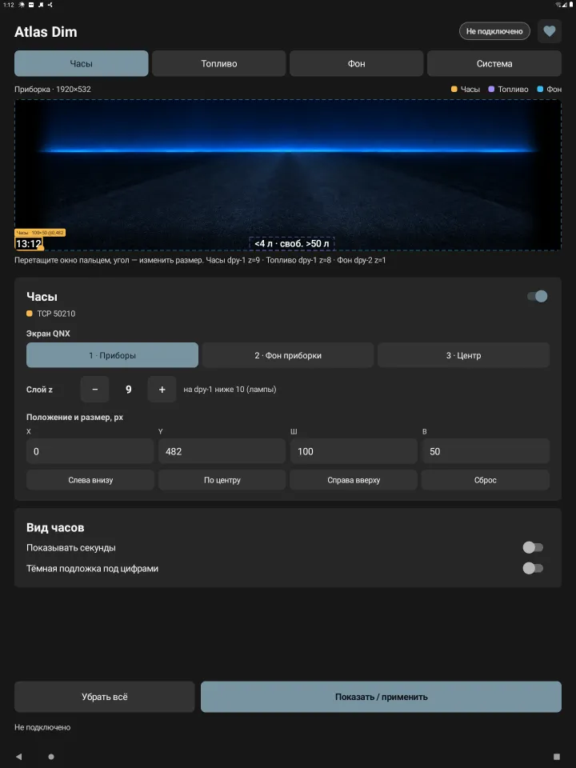
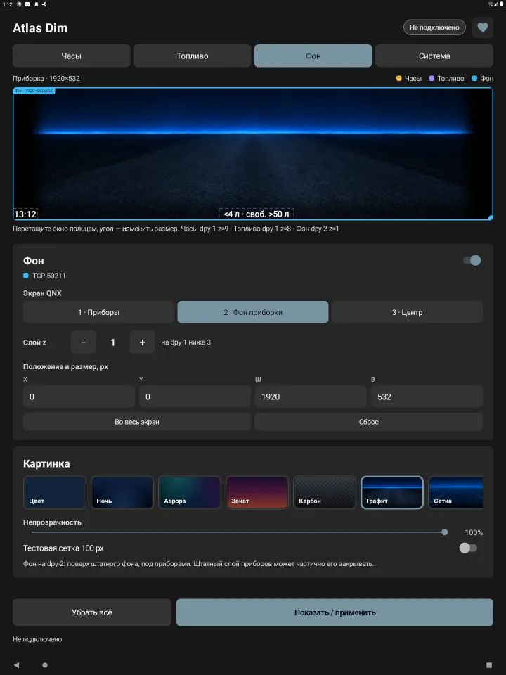
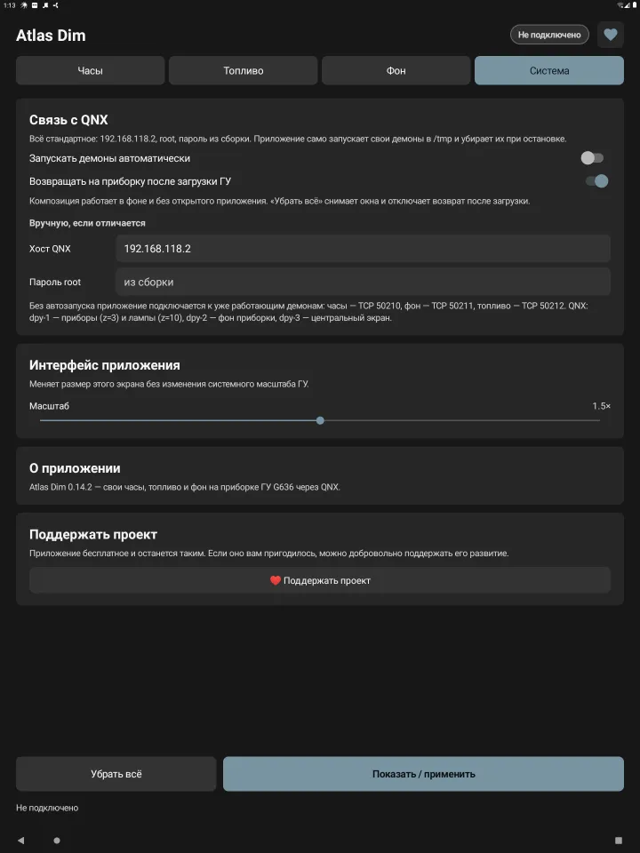

<p align="center">
  
</p>

<h1 align="center">Atlas Dim</h1>

<p align="center">Свои часы, топливо и фон на приборке ГУ Geely G636 / OneOS</p>

Atlas Dim выводит на приборку (DIM) небольшие окна поверх штатного Kanzi: часы, остаток
топлива из [GInputBridge](https://github.com/mmwtl/GInputBridge) и фон под приборами.
Android-окна на приборку не попадают, поэтому приложение запускает на QNX свои демоны
`ghudbridgelited-dim` в `/tmp` и передаёт им кадры по TCP. Штатные процессы QNX не
останавливаются и не меняются; после перезагрузки ГУ на QNX ничего нашего не остаётся.

Принцип работы взят из [ANHUD](https://github.com/g992/ANHUD) — см. раздел
[«Как это работает»](#как-это-работает).

Это исследовательский проект: выводы по приборке — в [notes/RESEARCH.md](notes/RESEARCH.md),
команды на ГУ — в [notes/commands.md](notes/commands.md), план — в [TASK.md](TASK.md).

## Интерфейс

<p align="center">
  
  
  
</p>

Под заголовком закреплены вкладки и предпросмотр приборки 1920×532: окно выбирается и
двигается пальцем, угол меняет размер. Внизу — «Показать / применить» и «Убрать всё».

- «Часы», «Топливо», «Фон» — экран QNX (приборы, фон приборки, центральный), слой z,
  положение и размер, быстрые позиции и сброс окна; у часов — секунды и подложка, у топлива —
  что показывать и формула литров, у фона — цвет, встроенные картинки, свои картинки
  из галереи и непрозрачность;
- «Система» — связь с QNX (хост, пароль, автозапуск демонов, возврат после загрузки ГУ),
  масштаб интерфейса, версия, обновления через GStore и поддержка проекта.

Композиция держится службой с уведомлением и работает без открытого приложения.

## Как это работает

Схему вывода на приборку придумал и реализовал проект
[ANHUD](https://github.com/g992/ANHUD) (HUD на Geely N155); Atlas Dim применяет её
к приборке G636:

1. Приложение копирует демон `ghudbridgelited` из ANHUD в `/tmp` на QNX (через NFS-шару
   или telnet) и запускает его. Демон открывает прозрачное окно QNX Screen на нужном
   экране и слое z.
2. Android рисует часы, топливо и фон на Canvas и шлёт кадры демону по TCP
   по протоколу gcp/1 из ANHUD.
3. При потере связи демон сам убирает окно; после перезагрузки ГУ `/tmp` очищается.

Отличия от ANHUD: демон `qnx/ghudbridgelited-dim` пропатчен под приборку (экран, размер
окна до 1920×532, позиция окна), несколько демонов работают одновременно на своих портах,
а клиент протокола и telnet-shell перенесены на Java. Подробности — в
[notes/RESEARCH.md](notes/RESEARCH.md) и [NOTICE](NOTICE).

## Установка

Для установки и автоматического обновления рекомендую магазин приложений **GStore**:
[скачать GStore](https://disk.yandex.ru/d/bJoMhjqGw8rMtg). Подписанные APK также
выкладываются в [Releases](https://github.com/mmwtl/AtlasDim/releases).

## Сборка

Требуются JDK 17 и Android SDK 35.

```sh
./gradlew :app:assembleDebug
adb -s SERIAL install -r app/build/outputs/apk/debug/*.apk
```

APK появляется с именем `<versionName>[<versionCode>]AtlasDim-debug.apk`.

Релизная сборка `./gradlew :app:assembleRelease` требует локального файла подписи
`secure.signing.gradle` (путь задаётся `secure.signing` в `gradle.properties`); без него
release не собирается.

## Благодарности

- [ANHUD](https://github.com/g992/ANHUD) — демон `ghudbridgelited`, протокол gcp/1 и сам
  принцип вывода из Android на экраны QNX.
- [GInputBridge](https://github.com/mmwtl/GInputBridge) — данные о топливе.

## Лицензия

[MIT](LICENSE) — для собственного кода Atlas Dim. Компоненты из ANHUD (демон, перенесённые
классы протокола и telnet) остаются под условиями ANHUD, см. [NOTICE](NOTICE).
